  

# Hi, I'm Afonso! 👋

I'm a student based in Porto, Portugal, interested in technology, learning new skills, and building practical projects.

### Currently
- Working on personal and academic projects.
- Exploring new technologies and expanding my technical skills.

### Projects
Here are some of the projects I've worked on:

- **[Data Warehouse Project](https://github.com/Afonsosequeira04/Data-Warehouse-Project)** – Building a cloud-based data lakehouse platform.
- **[My AWS Project](https://github.com/Afonsosequeira04/My-AWS-Project-Source-Code)** – Exploring AWS cloud services.
- **[Verly](https://github.com/Afonsosequeira04/Verly-app)** – Developing an AI-powered expense management application.
- **[TrabalhoPWC](https://github.com/Afonsosequeira04/TrabalhoPWC)** – Website design and development project.

Feel free to explore my repositories!
